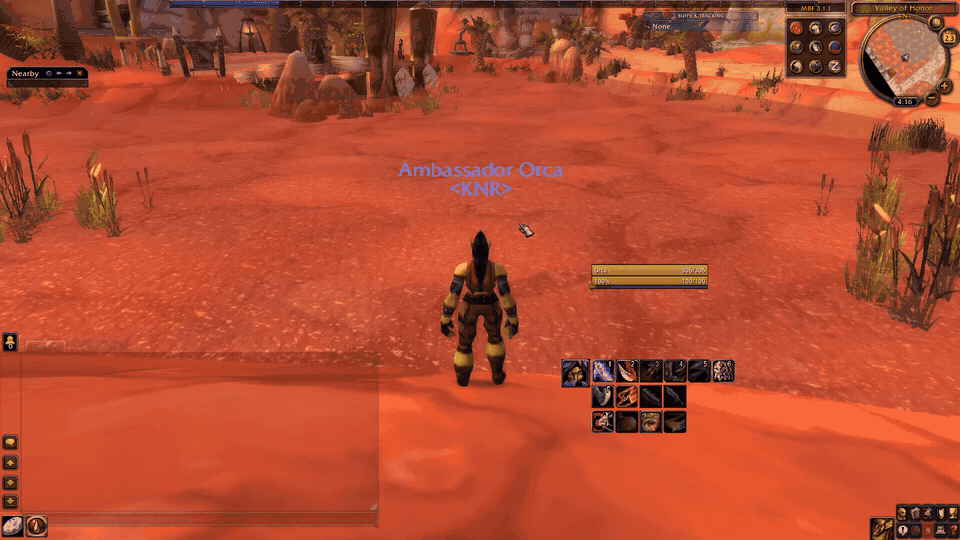

# mod-selfbot-fishing

Small selfbot fishing controller for AzerothCore with `mod-playerbots`.

The module exposes `.sbfish start`, `.sbfish stop`, and `.sbfish status`. It enables Playerbots' existing `master fishing` strategy on the issuing selfbot. That strategy searches nearby game objects for fishing pools, finds a nearby shore position, casts, and uses the bobber when it is ready.

## Example run

This short animation shows starting selfbot fishing from CompactGM, two catches, and stopping fishing from the same menu. The quiet time between starting and stopping is cut; the actions remain in their original order.

Full-size screenshots: [fishing start](docs/images/fishing-started.png) · [active cast and catch](docs/images/fishing-cast-and-catch.png).

## Requirements

- AzerothCore WotLK with `mod-playerbots` enabled.
- The character must have Fishing and be active as a selfbot (`.playerbots bot self`).
- For the local stationary-fishing behavior, apply the separate patch documented in [`patches/README.md`](patches/README.md).

## Selfbot permissions

This module uses Playerbots' existing selfbot access rules; `.sbfish start` does not bypass them. Set `Playerbots.SelfBotLevel` in `playerbots.conf`:

- `0` — selfbot disabled.
- `1` — GM accounts only (the Playerbots default).
- `2` — all player accounts.
- `3` — activate selfbot automatically on login.

## Build and use

Add this directory under `modules/`, rebuild the worldserver, and restart it. In game, use:

- `.sbfish start` — activate the existing Playerbots fishing strategy.
- `.sbfish stop` — remove the fishing strategy and any pending bobber-use strategy.
- `.sbfish status` — show whether fishing is active.

The module reuses Playerbots' stock fishing behavior. It does not make independent changes to pool selection or pathfinding. This module makes no database changes.

While fishing is active, the module temporarily suspends the selfbot's roaming, questing, gathering, and similar movement strategies, and clears any existing movement path. It restores the suspended strategies when fishing stops if the selfbot was already active. If the module enabled the selfbot, stopping fishing turns it off.

## Quest-start items

While the selfbot is active, Playerbots may automatically use eligible quest-starting items in the character's bags. This can happen after a normal fishing catch or another item-loot event, even when the quest item was already in the bags before fishing began. This behavior comes from Playerbots' item handler, not from this fishing module.

## Playerbots source patch

The local server checkout has an additional change to `CheckMountStateAction` so a selfbot remains dismounted while the `master fishing` strategy is active, and autonomous bots wait five seconds before remounting after becoming eligible. The exact patch and base commit are recorded in [`patches/README.md`](patches/README.md). The module can compile without that patch, but the local stationary-fishing behavior depends on it.

## License

The original selfbot fishing module is licensed under the MIT License; see [`LICENSE`](LICENSE). The separate patch under `patches/` modifies GPL-2.0-only Playerbots source and is licensed under GPL-2.0-only; see [`patches/LICENSE`](patches/LICENSE). AzerothCore and Playerbots remain under their own licenses.

## Compatibility and provenance

This is an unofficial community module for AzerothCore WotLK with `mod-playerbots`. It was developed in a Yu'Lon-managed local installation whose server source came from `mod-playerbots/azerothcore-wotlk` at commit `32fd3472aa74961c91cb9bc942ee3e0a44b36779`, with `mod-playerbots/mod-playerbots` at commit `ecc4a537a3b43056e412fae63fb4a4271849b472`. The included patch is a local change against that Playerbots commit. Yu'Lon manages the installation; it is not the source of the upstream core or Playerbots code. Compatibility with other revisions is not guaranteed.

This project is not affiliated with or endorsed by AzerothCore, the Playerbots project, Yu'Lon, Blizzard Entertainment, or World of Warcraft.
